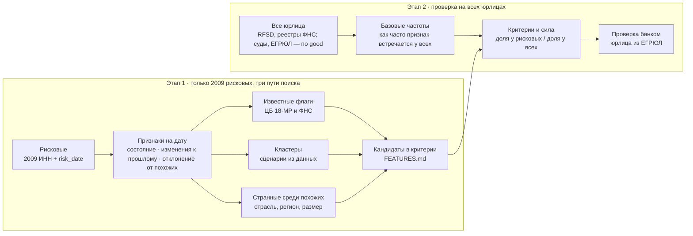

# PSB-115: подход к выявлению риска по 115-ФЗ

Ищем в открытых данных, что общего у 2009 компаний из списка банка и что у них менялось перед датой риска по 115-ФЗ. Найденные признаки проверяем на распространённость среди всех юрлиц и отдаём банку только те критерии, которые действительно отличают рисковых.

## Постановка

Банк ждёт критерии, по которым из открытых данных можно предвидеть тот же риск по 115-ФЗ, что у компаний из файла и понимание, как эти критерии работают вместе.

**Постановка задачи от банка**:

- **Данные:** список 2009 ИНН юрлиц и дата, когда у компании возник риск (`risk_date`). У каждой компании в датасете одна такая дата. Хороших компаний не дают.
- **Цель:** связать эти даты с изменениями в отчётности, судах и других открытых источниках и предсказывать именно этот риск. Формализованных инструментов с моделями для этого сейчас нет.
- **Вход:** по задумке только ИНН. Если нужны дополнительные данные, банк подаст их сам.
- **Результат:** чётких критериев приёмки нет. Найти зависимости, по которым можно предвидеть риск, — уже хороший результат.
- **Проверка банком:** по нашим критериям банк выгрузит из ЕГРЮЛ другие юрлица и проверит, есть ли у них тот же риск.

**Допущения (худший сценарий, пока нет других ответов):**

- Все данные собираем сами из открытых источников, в том числе базовые частоты признаков по всем юрлицам.
- Критерии качества определяем сами (раздел «Как проверяем»).

## Данные

Динамика есть только у бухотчётности: у 1628 из 2009 компаний до `risk_date` доступно хотя бы 2 годовых отчёта, у 1355 — 3 и больше, у 202 — ни одного. Суды, ФНС и ЕГРЮЛ пока собраны на одну дату.

| Источник | Что даёт | Период | Динамика | Покрытие из 2009 |
|---|---|---|---|---|
| Файл банка = ГИР БО, формы 1–2 (открытые данные ФНС) | ~70 строк баланса и отчёта о прибылях | 2020–2025 | есть | 1920 |
| RFSD (тот же ГИР БО) | 19 показателей, движение денег, ОКВЭД, регион, возраст | 2022–2025 | есть | 1904 |
| Арбитраж (kad.arbitr.ru) | число дел, роли, даты первого и последнего дела | на 05.10.2026 | нет | дела у 1444 |
| ФНС: долги | сумма недоимки, пеней, штрафов | одна дата | нет | 47% в реестре |
| ФНС: уплаченные налоги, численность | суммы по видам налогов, среднесписочная численность | 2025 | нет | 97% / 84% |
| ФНС: спецрежимы | УСН, АУСН, ЕСХН | текущий реестр | нет | 25% |
| DaData (ЕГРЮЛ) | статус, ОПФ, адрес, дата назначения нынешнего директора | текущий срез | нет | 100% |

**Финансы — только из RFSD.** Файл банка и RFSD — один первоисточник (совпадение 99,6–100%), но обработка у них разная. Чтобы разница в обработке не стала ложным признаком, и для рисковых, и для базовых частот берём одно — RFSD: в полной базе 2011–2025 годы и около 187 показателей. Файл банка — только для сверки.

**Чего не хватает:** полной выгрузки RFSD (у Миши только 2022–2025 и 19 показателей), даты каждого арбитражного дела и выгрузок ФНС прошлых лет. Подробная сверка данных — в `docs/DATASET.md` и `docs/HANDOFF_REVIEW.md`.

## Ключевой вывод: «общее» — не значит «отличает»

Для анализа и кластеров хватает 2009 рисковых компаний — именно это просил куратор. Но банк проверит критерии на всех юрлицах из ЕГРЮЛ, поэтому критерий полезен, только если у рисковых он встречается **заметно чаще, чем у всех**.

Пример: у 98% компаний из списка ноль филиалов, 99% из них — ООО. Это самое общее у 2009 компаний, но то же верно почти для любой малой компании: по такому критерию банк получит огромный список почти без рисковых.

Поэтому для каждого кандидата в критерии считаем **базовую частоту** — как часто он встречается у всех юрлиц. Основные источники для этого — массовые: RFSD (отчётность всех компаний) и реестры ФНС. Выборку Миши из реестра МСП (1769 компаний) тоже используем, но с учётом перекоса: в ней только действующие компании, перекос по ОПФ и УСН. После старта проверки гипотез её можно расширить.

## Подход

Работаем в два этапа. Сначала изучаем только 2009 рисковых компаний, как просил куратор. Потом проверяем найденное на распространённость среди всех юрлиц и отдаём банку только те критерии, которые отличают рисковых.

Этап 1 изучает только 2009 рисковых. Массовые источники нужны лишь как точка сравнения: медианы похожих компаний на этапе 1 и базовые частоты на этапе 2.

1. **Этап 1: что общего у рисковых.** Разведочный анализ 2009 компаний: распределения признаков на дату риска, типичные значения, что встречается у большинства.
2. **Признаки на дату** — только то, что было известно до даты среза `as_of` (для рисковых `as_of` = `risk_date`). Годовой отчёт за год Y считаем доступным с 1 апреля Y+1. Три вида:
   - **Состояние:** выручка на сотрудника, нет основных средств и запасов при большой выручке, налоговая нагрузка, долги перед ФНС, суды, возраст, уставный капитал.
   - **Изменения к собственному прошлому:** резкий рост или обвал выручки, капитал ушёл в минус, перестала сдавать отчётность, смена руководителя, новые иски. Компанию сравниваем с ней же за 1–3 года до даты.
   - **Отклонение от похожих:** налоговая нагрузка, выручка на сотрудника, рентабельность относительно медианы своей отрасли, региона и размера. Медианы считаем по RFSD, где есть все компании.
3. **Три пути поиска кандидатов** — куратор просил «посмотреть различные варианты, как возможно выявить рисковых». Кандидаты всех трёх путей — в `docs/FEATURES.md`.
   - **Известные флаги** — гипотезы из практики. Методические рекомендации ЦБ 18-МР от 21.07.2017: налоги около 0,9% от оборота по счёту и ниже, нет зарплаты при оборотах, НДФЛ без страховых взносов, резкий рост оборотов. 12 критериев самостоятельной оценки рисков ФНС (приказ ММ-3-06/333@): налоговая нагрузка и рентабельность ниже отраслевой, убытки 2 года и больше, расходы растут быстрее доходов. Переводим их в признаки и смотрим, у какой доли из 2009 они срабатывают. Оборотов по счёту у нас нет, поэтому часть флагов считаем через приближения, например налоги / выручка. Выдержки из источников — в `docs/sources/`.
   - **Кластеры** — гипотезы из данных. Группируем рисковые компании по похожим признакам. Каждая группа — сценарий риска, о котором заранее не знали.
   - **Странные среди похожих** — поиск аномалий внутри групп по отрасли, региону и размеру (Isolation Forest, LOF): чем компания необычна по сравнению с похожими.
4. **Этап 2: базовые частоты.** Для каждого признака-кандидата считаем, как часто он встречается у всех юрлиц за те же годы. Сила критерия — доля среди рисковых, делённая на долю среди всех. Критерии, которые у всех встречаются так же часто (ООО, ноль филиалов), отбрасываем.
   - **Финансы и налоги — по всем юрлицам.** RFSD и реестры ФНС скачиваются целиком.
   - **Суды и ЕГРЮЛ — по выборке good.** kad.arbitr и DaData собираются по одному ИНН и с лимитами, на все юрлица их не собрать. По 1769 компаниям good Миша их уже собрал. Для признаков вроде «3+ иска в роли ответчика» или «директор сменился за год» считаем долю у good за те же годы, что и даты риска, — это и есть оценка базовой частоты.
   - **Поправка на перекос good:** в ней только действующие компании МСП, с перекосом по ОПФ и УСН. Сравниваем внутри одинаковых групп по ОПФ и УСН; различие, которое объясняется перекосом, критерием не считаем.
   - **Ограничения:** для судов нужны даты каждого дела (вопрос 3 к Мише), иначе не понять, в каком году было дело. Если good не хватит или перекос окажется слишком сильным — расширяем выборку. Полноценную фоновую выборку со сбором всех источников делаем, только если good не хватит.
5. **Результат.** Критерии с силой и покрытием, их сочетания и описание кластеров. Классификатор и полная фоновая выборка — только если без них не обойтись, например чтобы оценить сочетания многих признаков сразу.

Абсолютную вероятность честно посчитать нельзя: неизвестно, какая доля всех компаний рисковая. До прогона банка по ЕГРЮЛ даём «во сколько раз выше среднего»; реальную долю попаданий покажет этот прогон.

## Как проверяем

Критерии качества задаём сами. Чтобы не подогнать критерии под эти 2009 компаний, делим по времени: ищем закономерности на рисках с датой до 2025 года и смотрим, держатся ли они на рисках 2025–2026.

| Метрика | Что показывает | Как считаем |
|---|---|---|
| Сила критерия | Во сколько раз критерий чаще у рисковых, чем у всех | Доля среди рисковых / базовая частота среди всех юрлиц за те же годы, с доверительным интервалом |
| Покрытие | Какую часть рисковых ловит критерий | Доля из 2009 компаний, у которых критерий сработал |
| Опережение | Виден ли риск заранее. Ключевая метрика: отделяет предсказание от выявления уже идущего риска | Сила и покрытие по данным за 1 и 2 года до `risk_date` |
| Устойчивость | Не случайны ли критерии | Совпадает ли список сильных критериев на разных годах и подвыборках |

Среди всех юрлиц есть и неизвестные рисковые компании, поэтому сила критерия скорее занижена, чем завышена. Итоговая проверка — прогон банка по ЕГРЮЛ: доля отобранных компаний, у которых риск подтвердился.

## Ближайшие шаги

Первый результат для банка — что общего у 2009 рисковых и как они менялись перед датой риска. Затем — какие из этих признаков действительно их отличают.

- [ ] Выгрузить полную RFSD по 2009 рисковым в таблицу «ИНН × год» (2016–2025, все показатели: самые ранние даты риска — 2022, плюс 2 года — чтобы проверить признаки заранее (опережение), и 3 года истории до них), добавить проверки в `scripts/verify_dataset.py`
- [ ] Разведочный анализ 2009 компаний: состояние на дату и изменения за 1–3 года до неё
- [ ] Известные флаги ЦБ и ФНС перевести в признаки; кластеры и «странные среди похожих»; кандидаты всех трёх путей — в `docs/FEATURES.md`
- [ ] Получить ответы Миши (`docs/QUESTIONS.md`): даты арбитражных дел, архивы ФНС прошлых лет
- [ ] Посчитать базовые частоты кандидатов по RFSD и реестрам ФНС, отбросить не отличающие
- [ ] Решить, нужны ли классификатор и полная фоновая выборка

**Открытые вопросы:**

- Какая доля всех юрлиц рисковая — от этого зависит, сколько компаний банк получит по критерию и сколько из них окажутся рисковыми. Ответ даст прогон банка.
- Хватит ли выборки good для базовых частот по судам и ЕГРЮЛ: зависит от силы перекоса и от того, есть ли даты арбитражных дел. Если не хватит — расширяем выборку.
