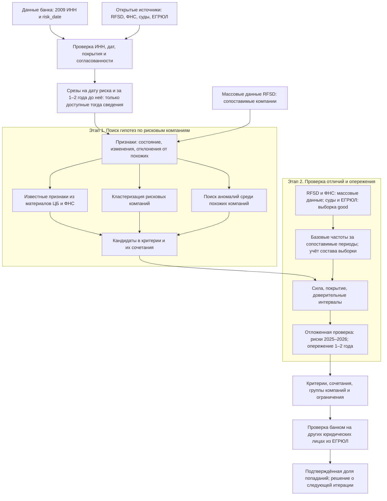

# PSB-115: выявление признаков риска по 115-ФЗ из открытых данных

Документ описывает цели, требования, данные и схему решения для первой исследовательской итерации проекта. Предлагаемые условия приёмки требуют согласования с банком.

## 1. Зачем идём в разработку продукта

Проект предоставлен в рамках семетсровой практики. Банк передал список 2009 юридических лиц с датой возникновения риска по 115-ФЗ (`risk_date`). Требуется найти в открытых данных признаки, которые позволят заранее выявлять компании с тем же риском, и объяснить, как эти признаки работают вместе. Согласно исходной постановке, формализованных инструментов с моделями для этой задачи у банка сейчас нет.

Пользователь результата — специалист банка, который проверяет юридических лиц на риск. На вход предполагается подавать ИНН, а на выходе получать сработавшие критерии, подтверждающие их данные и оценку того, насколько эти критерии характерны для компаний из списка банка.

Бизнес-ценность — возможность обоснованно отбирать компании для дополнительной проверки. Первая итерация должна показать, есть ли в доступных данных отличительные признаки риска и за какое время до `risk_date` они становятся видны. Экономический эффект и допустимое число компаний для проверки пока не определены; обещать их количественное улучшение на этом этапе нельзя.

## 2. Бизнес-требования и ограничения

### 2.1. Требования к результату

| Требование | Как отражается в решении |
|---|---|
| Предвидеть риск, зафиксированный банком | Проверять признаки не только на `risk_date`, но и за один и два года до неё |
| Получать исходные сведения по ИНН | Связывать источники по ИНН; дополнительные входные данные использовать, если их предоставит банк |
| Давать объяснимые критерии | Для каждого критерия указать формулу, порог, источник, доступность данных, покрытие и ограничения |
| Отличать рисковые компании от остальных | Сравнивать распространённость критерия среди рисковых и в общей совокупности, а не ограничиваться сходством внутри 2009 компаний |
| Показать совместное действие признаков | Описать сочетания критериев и типичные группы компаний; измерить покрытие сочетаний с учётом пересечений |
| Обеспечить проверку банком | Передать воспроизводимые правила отбора, по которым банк сможет выбрать другие юридические лица из ЕГРЮЛ и проверить наличие того же риска |

### 2.2. Ограничения

- Банк не предоставил подтверждённые примеры компаний без риска. Список 2009 компаний содержит только положительные примеры, причём у каждой компании одна `risk_date`.
- Доля рисковых компаний среди всех юридических лиц неизвестна. На текущих данных нельзя надёжно оценить абсолютную вероятность риска или долю верных срабатываний в будущей проверке банка.
- Выборка `good` из 1769 компаний не является подтверждённым набором компаний без риска. В ней представлены действующие компании МСП, есть перекосы по организационно-правовой форме и применению УСН.
- Историческая динамика сейчас доступна главным образом для бухгалтерской отчётности. Текущие срезы судов, ФНС и ЕГРЮЛ нельзя автоматически считать сведениями, известными до `risk_date`.
- Массовые данные доступны в RFSD и реестрах ФНС. Суды и сведения ЕГРЮЛ через DaData собираются по отдельным ИНН с ограничениями, поэтому для них базовые частоты оцениваются по выборке.
- Финансовые признаки для рисковых компаний и совокупности сравнения рассчитываются из RFSD. Файл банка используется для сверки: различия обработки одного первоисточника не должны становиться ложным отличием групп.
- По текущему допущению команда самостоятельно собирает открытые данные и определяет исследовательские критерии качества. Бюджет, сроки, требования к скорости обработки и формальные пороги приёмки банком не заданы.

### 2.3. Предлагаемые условия приёмки первой итерации

Это предложение команды, а не согласованные обязательства перед банком:

1. Подготовлена таблица признаков по 2009 ИНН с датами срезов, источниками, пропусками и ограничениями доступности данных.
2. Для каждого проверенного критерия представлены доля срабатываний у рисковых, базовая частота, их отношение и доверительный интервал. Отброшенные гипотезы также зафиксированы с причиной отказа.
3. Для перспективных критериев показаны результаты на отложенном периоде и за один и два года до риска. Если данных для такой проверки нет, это явно указано.
4. Описаны сочетания критериев и группы компаний; банк может воспроизвести отбор по переданным правилам.
5. Отсутствие устойчивых отличительных критериев считается допустимым исследовательским выводом. В таком случае документируются проверенные гипотезы и недостающие данные, а не заявляется готовность инструмента к применению.

Численные требования к силе критериев, покрытию и числу отбираемых компаний нужно согласовать после первичного анализа и уточнения возможностей проверки банка.

## 3. Что входит в объём проекта и первой итерации

### Входит

- Проверка исходных данных, покрытия источников, дат и согласованности финансовых показателей.
- Получение полной финансовой истории RFSD по рисковым компаниям за 2016–2025 годы, если она доступна. Этот диапазон нужен для проверки опережения и нескольких лет предшествующей истории.
- Разведочный анализ 2009 компаний: состояние на дату, изменения относительно собственного прошлого и отклонения от похожих компаний.
- Три направления поиска гипотез: известные признаки из материалов ЦБ и ФНС, кластеризация рисковых компаний, поиск аномалий среди сопоставимых компаний.
- Расчёт базовых частот по массовым источникам и по выборке `good`, проверка влияния состава выборки.
- Проверка критериев во времени, оценка опережения, описание сочетаний признаков и подготовка материалов для проверки банком.

### Не входит в первую итерацию

- Обязательное обучение классификатора и построение полной фоновой выборки со всеми источниками. Они рассматриваются отдельно, если без них нельзя оценить совместное действие признаков или проверить гипотезы.
- Расчёт калиброванной абсолютной вероятности риска по имеющимся данным.
- Разработка промышленного сервиса, интерфейса, интеграции с системами банка и мониторинга в эксплуатации.
- Автоматическое принятие решений в отношении компаний и подмена банковской оценки юридическим заключением.
- Предсказание любых финансовых или налоговых нарушений: целевое событие ограничено тем риском, который банк обозначил через `risk_date`.

## 4. Предпосылки решения

### 4.1. Доступные данные

| Источник | Содержание и период | Покрытие среди 2009 компаний | Роль в решении |
|---|---|---|---|
| Файл банка: ГИР БО, формы 1–2 | Около 70 строк отчётности за 2020–2025 годы | 1920 компаний | Сверка финансовых данных |
| Текущая выгрузка RFSD | 19 финансовых показателей, движение денег, ОКВЭД, регион, возраст; 2022–2025 годы | 1904 компании | Основной источник финансов; требуется расширение выгрузки |
| Арбитраж | Число дел, роли, даты первого и последнего дела; срез на 05.10.2026 | Дела есть у 1444 компаний | Судебные признаки; для истории нужны даты каждого дела |
| ФНС: задолженность | Недоимка, пени, штрафы; один срез | В реестре присутствуют 47% | Признаки задолженности с учётом даты среза |
| ФНС: налоги и численность | Уплаченные налоги и среднесписочная численность за 2025 год | 97% и 84% соответственно | Налоговая нагрузка и показатели на сотрудника |
| ФНС: специальные режимы | УСН, АУСН, ЕСХН; текущий реестр | В реестре присутствуют 25% | Признаки режима и сопоставление групп |
| DaData / ЕГРЮЛ | Статус, организационно-правовая форма, адрес, дата назначения нынешнего директора; текущий срез | 100% | Характеристики компании с ограничениями исторической доступности |

Присутствие в реестре и полнота данных — разные понятия: отсутствие записи нельзя без проверки трактовать как нулевое значение признака.

До `risk_date` хотя бы два годовых отчёта доступны у 1628 компаний, три и более — у 1355, ни одного — у 202. Эти числа описывают доступную историю; для каждого расчёта дополнительно проверяется, мог ли соответствующий отчёт быть известен на дату среза. Полная база RFSD содержит данные за 2011–2025 годы и около 187 показателей, но нужная выгрузка ещё не получена.

### 4.2. Основные гипотезы и допущения

1. Перед датой риска у части компаний меняются финансовые и иные открытые показатели. Возможность увидеть эти изменения заранее предстоит проверить.
2. Сходство рисковых компаний само по себе недостаточно. Например, распространённые признаки «ООО» и «нет филиалов» полезны только при наличии отличия от сопоставимой совокупности.
3. Отрасль, регион и размер компании влияют на нормальные значения показателей. Отклонения нужно оценивать относительно сопоставимых компаний, а не единого среднего для всех.
4. `risk_date` используется как дата целевого события, переданная банком. Её точный смысл и задержку относительно фактического возникновения риска следует уточнить.
5. Рабочее допущение: годовой отчёт за год Y доступен с 1 апреля Y+1. Это приближение, а не подтверждённая дата публикации каждого отчёта; при наличии фактических дат следует использовать их и учитывать поздние исправления.
6. Налоги, делённые на выручку, могут использоваться как исследовательское приближение. Этот показатель не равен отношению налогов к обороту по банковскому счёту, которого в данных нет.
7. Общая совокупность и выборка `good` могут содержать неизвестные рисковые компании. Их нельзя целиком размечать как отрицательные примеры.

## 5. Постановка задачи

### 5.1. Формализация

Первая итерация — поиск объяснимых закономерностей по положительным примерам с последующей проверкой их распространённости в общей совокупности. Обычная бинарная классификация пока не является основной постановкой, поскольку подтверждённого отрицательного класса нет.

Единица расчёта — пара «ИНН, дата среза `as_of`». Для каждого ИНН строится набор признаков только из сведений, доступных на эту дату. Для рисковых компаний используются три среза: `risk_date`, за один год и за два года до неё. На каждом срезе изменения рассчитываются относительно доступной предшествующей истории за 1–3 года.

Критерий — воспроизводимое условие над одним или несколькими признаками. Результат его применения к компании: сработал, не сработал либо недостаточно данных. Последний исход учитывается отдельно и не приравнивается к отсутствию риска.

### 5.2. Построение и поиск признаков

- **Состояние компании:** выручка на сотрудника, основные средства и запасы относительно выручки, налоговая нагрузка, задолженность, судебная активность, возраст и уставный капитал.
- **Изменения:** рост или падение выручки, переход капитала в отрицательную область, прекращение сдачи отчётности, смена руководителя, новые иски. Последние признаки используются в исторической проверке только при наличии необходимых дат и истории.
- **Отклонения от похожих компаний:** налоговая нагрузка, рентабельность и выручка на сотрудника относительно отрасли, региона и размера. Для малочисленных групп потребуется укрупнять совокупность сравнения и фиксировать это в методике.

Известные признаки из материалов ЦБ и ФНС используются как гипотезы. Кластеризация помогает описать типичные группы внутри рисковых компаний. Методы Isolation Forest и LOF рассматриваются для поиска необычных компаний среди сопоставимых. Принадлежность кластеру или высокая аномальность сами по себе не подтверждают риск: полученные гипотезы проходят общую проверку базовых частот.

### 5.3. Проверка качества

Правила и пороги подбираются на компаниях с `risk_date` до 2025 года. Компании с датами риска в 2025–2026 годах используются для отложенной проверки; по её результатам пороги повторно не подбираются. Базовые частоты рассчитываются для соответствующих периодов и сопоставимых условий доступности данных.

Обозначим долю рисковых компаний, удовлетворяющих критерию, как `p_risk`, а долю в совокупности сравнения — как `p_base`. Для обоих показателей указываются числитель, знаменатель и число компаний с недостаточными данными.

| Показатель | Расчёт и назначение |
|---|---|
| Сила критерия | `p_risk / p_base` с доверительным интервалом: насколько чаще критерий встречается у рисковых |
| Покрытие | Доля рисковых компаний, для которых подтверждено срабатывание; отдельно приводятся доступность признака и доля срабатываний среди компаний с достаточными данными |
| Опережение | Сила и покрытие на срезах за один и два года до `risk_date` |
| Устойчивость | Сохранение отличий на отложенном периоде, в разных годах и сопоставимых подгруппах |
| Результат проверки банка | Доля компаний с подтверждённым риском среди отобранных по правилам; станет доступна после проверки |

Отношение частот не является вероятностью риска конкретной компании. При нулевой или крайне редкой базовой частоте нужно показывать объём наблюдений и неопределённость оценки, а не заявлять бесконечную силу критерия.

Финансовые и налоговые базовые частоты рассчитываются по массовым источникам. Для судов и ЕГРЮЛ используется выборка `good`: сравнение проводится внутри сопоставимых групп по организационно-правовой форме и УСН. Это снижает влияние известных перекосов, но не гарантирует репрезентативность; при недостаточном объёме или несопоставимости выборку потребуется расширить.

### 5.4. Защита от использования будущих сведений

Дата события, отчётный период и дата доступности сведений хранятся раздельно. При построении признаков на `as_of` запрещено использовать сведения, появившиеся позже этой даты. Пропуски, отсутствие отчётности и признаки изменений также определяются только по доступной на тот момент информации.

Текущий статус компании, нынешний директор, сегодняшняя задолженность и суммарное число дел не включаются в исторические признаки без подтверждения их состояния на нужную дату. Если историю восстановить нельзя, такие данные остаются материалом описательного анализа; на них нельзя обосновывать способность предвидеть риск.

## 6. Блок-схема решения

Массовые данные на первом этапе служат основой для сравнения с похожими компаниями. Поиск общих сценариев проводится по 2009 рисковым компаниям; проверка того, насколько найденное отличает их от общей совокупности, выделена во второй этап.

## 7. Результаты итерации, риски и следующие шаги

### 7.1. Передаваемые материалы

- Описание источников, покрытия, правил доступности данных и формирования признаков.
- Таблица признаков по ИНН и датам срезов с отметками о недостаточных данных.
- Каталог проверенных критериев: формулы, пороги, источники, сила, покрытие, опережение, устойчивость и ограничения.
- Описание групп рисковых компаний и сочетаний критериев с учётом пересечения срабатываний.
- Правила отбора для проверки банком и перечень вопросов, которые эта проверка должна разрешить.

### 7.2. Основные риски исследования

| Риск | Как учитываем |
|---|---|
| Признак описывает последствия уже возникшего риска | Проверяем опережение и даты доступности исходных сведений |
| Найдено обычное свойство малого бизнеса | Сравниваем с базовой частотой и сопоставимыми компаниями |
| Отличие вызвано составом выборки `good` | Сравниваем внутри одинаковых групп; при необходимости расширяем выборку |
| Критерии подогнаны под 2009 компаний | Отделяем подбор от проверки по времени, учитываем неопределённость и устойчивость |
| Для части компаний нет истории | Показываем покрытие и пропуски, ограничиваем выводы доступной совокупностью |
| Список банка не представляет все сценарии риска | Ограничиваем выводы переданным целевым событием; обобщение проверяет банк на других компаниях |

### 7.3. Следующие шаги и открытые вопросы

1. Получить полную выгрузку RFSD и проверить финансовую историю за 2016–2025 годы.
2. Уточнить смысл `risk_date`, получить даты отдельных арбитражных дел, архивы ФНС и доступные даты публикации сведений.
3. Провести анализ 2009 компаний и сформировать кандидатов по трём направлениям поиска.
4. Рассчитать базовые частоты, проверить перекосы выборки `good`, оценить критерии на отложенном периоде и до даты риска.
5. Согласовать с банком правила и объём внешней проверки, численные требования к результату и доступные ресурсы дальнейшей разработки.
6. По результатам решить, нужны ли расширенная фоновая выборка, классификатор и отдельная итерация по промышленному внедрению.

Главные неопределённости: можно ли восстановить исторические признаки вне бухгалтерской отчётности, достаточно ли выборки `good` для сравнения и какая доля отобранных компаний подтвердит риск при проверке банком.

### Доп материалы
В файле FEATURES.md указан словарь признаков, основанные на первичном сборе данных